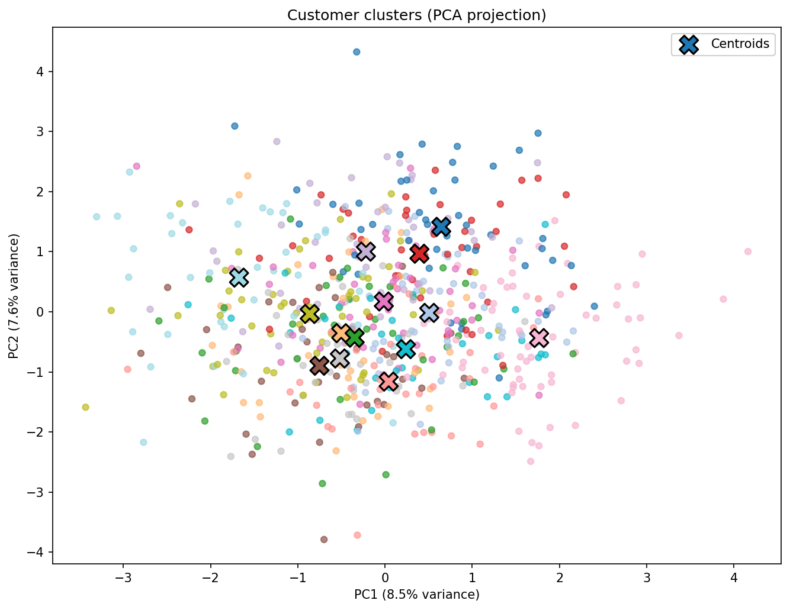

# DVD-Rental-customer-segmentation
Customer segmentation using PostgreSQL, K-Means clustering and Principal Component Analysis (PCA).

Customer Segmentation with KMeans
=================================

Key Results & Visualizations

PCA – Customer Segmentation

The PCA visualization provides a two-dimensional representation of the customer segments identified through K-Means clustering. It illustrates the degree of separation and overlap between the identified clusters.

What this folder contains
-------------------------
This package documents a customer clustering analysis on a
per-customer rental dataset (ratings, spend, and genre mix) based on a popular dataset; DVD rental database (dvdrental).

## Project files

- **README.md**  - description of individual files and their usage
- **DVDrental.pdf** – PDF report containing the project findings.
- **DatasetPeruCustomerAnalysis.py** – Python script used to generate the plots presented in the report. Requires `DatasetPerCustomerTable.csv`.
- **DatasetPerCustomer.sql** – SQL script used to create `DatasetPerCustomerTable.csv`. Requires the DVD Rental database (`.tar` file), which is not included in this repository.
- **DatasetPerCustomerTable.csv** – Processed customer dataset used as input for the Python analysis.
  
What the analysis does
----------------------
1. Load one row per customer (599 customers, 18 features).
2. Standardize features with StandardScaler.
3. Evaluate KMeans for k = 2..19; pick k with the highest silhouette score
   (here: k = 14, silhouette ~ 0.059).
4. Cross-check with Gaussian Mixture and Agglomerative (Ward) clustering.
5. Use GMM BIC/AIC (here BIC prefers k = 2) and a Ward dendrogram.
6. Fit final KMeans; interpret segments with PCA, a colour legend table,
   a standardized profile heatmap, and silhouette diagrams (also k = 5
   for contrast).

Plots the python file generates:
-----------------
  elbow_silhouette.png      Elbow (inertia) + silhouette vs k
  algorithm_comparison.png  Silhouette by algorithm
  gmm_bic_aic.png           GMM BIC and AIC
  dendrogram.png            Ward hierarchical dendrogram
  pca_clusters.png          Clusters in 2D PCA space
  cluster_legend.png        Plain-language cluster descriptions
  cluster_heatmap.png       Cluster profiles (std. deviations)
  silhouette_best_k.png     Per-sample silhouette for chosen k
  silhouette_k5.png         Per-sample silhouette for k = 5

Requirements
------------
Python 3.x with: pandas, numpy, matplotlib, scipy, scikit-learn, DatasetPerCustomerTable.csv (obtained from running the SQL file combined with the DVD rental .tar file)

Key result snapshot (from last run)
-----------------------------------
- **Customers**: 599
- **Chosen k** (KMeans silhouette): 14
- **Best silhouette**: ~0.059 (soft / overlapping segments)
- **GMM lowest BIC**: k = 2
- **Stand-out segment**: Cluster 9 — high ratings (4.74), high spend ($1959),
- **11% of customers**; sports / animation / scifi lean.
